# motor_ai_suites

[](https://github.com/aconstlink/motor_ai_suites/actions/workflows/cmake-win32-dx11.yml)
[](https://github.com/aconstlink/motor_ai_suites/actions/workflows/cmake-lin-gcc-gl.yml)
[](https://github.com/aconstlink/motor_ai_suites/actions/workflows/ctest-win32.yml)
[](https://github.com/aconstlink/motor_ai_suites/actions/workflows/ctest-linux.yml)

Applications, integration tests and benchmarks built with
[motor](https://github.com/aconstlink/motor), my C++ engine/framework.

The samples in this repository are developed with OpenAI's coding assistant and
reviewed and tested together with me. motor itself is my independently developed
engine. The goal is to exercise its public APIs, find bugs and bottlenecks, and
explore how the different systems work together in real applications.

motor is included as a Git submodule. The samples cover graphics, multiple
windows and backends, scene graphs, Wire connections, concurrency and document
processing. Each application is a separate CMake target.

## Rendering Performance

**5000 unlit cubes, one indexed draw per cube, no instancing or scene graph.**
CPU frame-start intervals in milliseconds; lower is better. Windows optimized
builds on an Intel Core i7-6700 / NVIDIA RTX 2060, VSync requested off.

| Framework / adapter | Backend | Historical, 2026-10-12 (ms) | motor follow-up, 2026-10-22 (ms) | Render-cache A/B, 2026-10-24 (ms) |
| --- | --- | ---: | ---: | ---: |
| motor | OpenGL 4 | 37.815 | 19.36 | **16.19 -> 7.27** |
| motor | D3D11 | 30.630 | 11.95 | Not tested |
| raylib | OpenGL | 17.492 | Not rerun | Not tested |
| bgfx | OpenGL | 2.369 | Not rerun | Not tested |
| bgfx | D3D11 | 1.858 | Not rerun | Not tested |
| Cinder | OpenGL | 2.518 | Not rerun | Not tested |
| ezEngine | D3D11 | 1.919 | Not rerun | Not tested |

**This is a workload reference, not a current engine ranking.** The historical
column is one retained multi-framework series (median of three run medians).
The motor follow-up averages three run medians from a later session; revisions,
drivers and background load changed. It shows roughly 49% / 61% lower motor
frame times, but does not establish a new head-to-head result against the other
frameworks. High d3d11 cube p95 values also remain; medians alone are not a
frame-pacing guarantee. These are not GPU timings or measured display FPS.

The 24 October column is a separate, controlled gl4 A/B test: caching program
and VAO bindings and removing the per-draw VAO unbind reduced the direct-cube
median by **55.1%**, with p95 **21.22 -> 9.97 ms**. Values are medians of three
run medians/p95s. It does not update the external-framework ranking. With the
full four-tile village, the same change showed **no stable gain**: median
**3.67 -> 3.70 ms**, p95 **5.24 -> 5.48 ms**. The later update-path cache change
was not part of these measurements.

Adapters differ in matrix/uniform handling and internal services. Cinder's
`Batch::draw()` and bgfx submissions still issue one draw per cube in this test.
The separately integrated native raylib and direct OpenGL references have their
own validation and measurement conditions; their results are not spliced into
the historical column.

[Historical comparison and methodology](comparison/RESULTS.md) |
[Render-cache A/B results and method](docs/D3D11_ASYNC_RENDERING.md#gl4-render-cache-comparison-2026-10-24) |
[Latest motor timings, p95 and progress](docs/D3D11_ASYNC_RENDERING.md#latest-alternating-backend-comparison) |
[Scene-graph preparation breakdown](suite_graphics/05_scene_benchmark.md#scene-preparation-breakdown-2026-10-22) |
[Native raylib results](suite_raylib/RESULTS.md) |
[Native rendering references](suite_reference/README.md)

## Start Here

- [VAO Lookup Benchmark](suite_graphics/19_vao_lookup.md): fixed draw count, increasing geometry links per render object, and an optional diagnostic linear/direct lookup comparison.
- [Debug Primitives](suite_graphics/17_debug_primitives.md): light markers, direction arrows and camera volumes using motor's primitive renderers.
- [Logger Regression Tests](suite_log/README.md): bounded storage, ring order, range copies, concurrent writers and logger routing.
- [Async Asset Loading](suite_graphics/16_async_assets.md): stream Sponza, then Suzanne into the running scene through motor's database and glTF importer.
- [Native Rendering References](suite_reference/README.md): optional bgfx, Cinder and direct OpenGL cube benchmarks beside raylib, with normal Visual Studio targets.
- [Datas Lock Comparison](docs/DATAS_LOCK_COMPARISON.md): updated GL4/D3D11 timings, lock on/off tests and historical framework references (2026-10-15).
- [Village 1800](suite_graphics/15_village.md): procedural houses and dragon, scene graph, collected lights, Wire, GPU particles and HDR postprocessing.
- [Render Access and Runtime Compilation](docs/RENDER_ACCESS_AND_COMPILE_COSTS.md): measured OID/status/variable lookup costs and motor/raylib shader compilation during rendering.
- [Live Recompile and Lock Costs](docs/RECOMPILE_AND_LOCKS.md): shader-layout changes during rendering and isolated `datas` measurements.
- [Variable Sets and Owner Queues](docs/VARIABLE_SET_AND_QUEUE_COSTS.md): name lookup versus cached pointers, and shared access versus message handoff.
- [Build and run](BUILDING.md): setup, basic applications, Wire and concurrency tests.
- [Scene Graph + Wire Lighting](suite_graphics/12_scene_wire_lighting.md): the combined integration sample.
- [Lighting Gallery](suite_graphics/11_lighting_scene.md): the corresponding low-level rendering sample.
- [Scene Benchmark](suite_graphics/05_scene_benchmark.md): workloads, measurements and their limitations.
- [gl4/d3d11 Async Rendering](docs/D3D11_ASYNC_RENDERING.md): updated cube/village timings, historical progress and the reproduced village shutdown hang with fix validation (2026-10-22).
- [Archived Engine Comparisons](comparison/README.md): measured results, methodology and a profiling checklist for motor. No external engine build integration.
- [Raylib Benchmark](suite_raylib/README.md): one optional native sample target with raylib as a directly linked external (`MOTOR_AI_BUILD_RAYLIB`).
- [Document Tokenization](suite_core/README.md): core tests, motor IO and tokenizer comparisons.
- [Math Tests](suite_math/README.md): vectors, matrices, transformations, utilities and quaternions.
- [Integration Notes](ENGINE_NOTES.md): historical findings and observations, with dates and tested revisions.

## Build

From the repository root, initialize the pinned engine and generate a build:

```sh
git submodule update --init --recursive
cmake -S . -B build
cmake --build build --config Release --target 12_scene_wire_lighting --parallel 4
```

With a Windows multi-configuration build, run
`build/bin/Release/12_scene_wire_lighting.exe`. For single-configuration generators,
set `-DCMAKE_BUILD_TYPE=Release` during configuration; executables are normally
under `build/bin`. See [BUILDING.md](BUILDING.md) for more examples.

## Graphics Applications

The gallery progresses from a triangle to shared resources, advanced GPU stages
and scene-level integration. Most later samples support `--gl-only`,
`--d3d-only`, `--still` and `--smoke`; consult the linked guide or source for the
options of each application. D3D11 requires Windows.

### 00 Triangle

A minimal geometry and msl shader example. The optional second window renders
the same graphics objects through a different backend.

[Source](suite_graphics/00_triangle.cpp) | [Run guide](BUILDING.md#initial-setup)

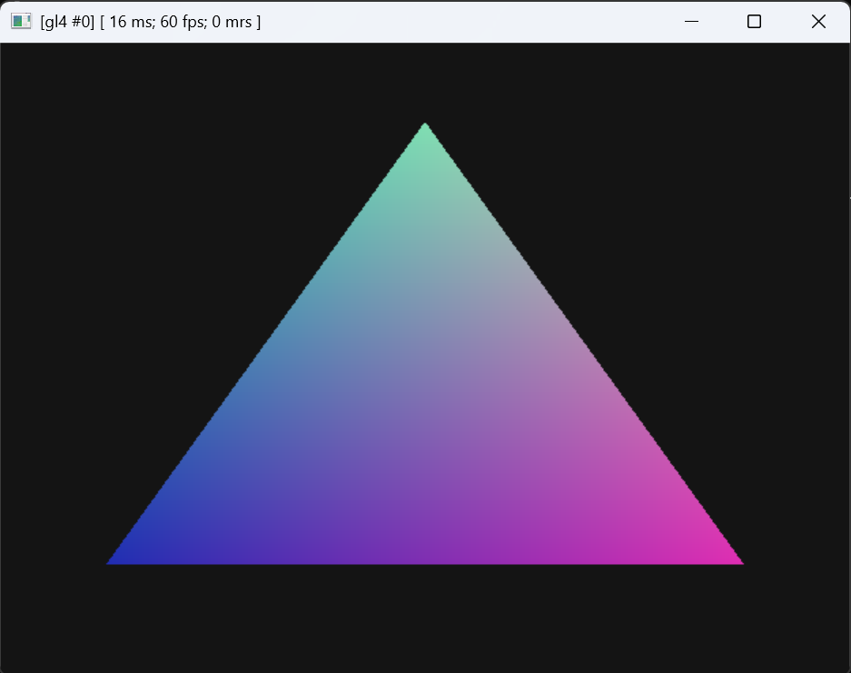

### 01 Window Lifecycle

Open and close a D3D11 window while the OpenGL window continues running.
On Linux, the secondary window uses OpenGL as well. Geometry, shader and color
data are shared across the windows.

[Source](suite_graphics/01_window_lifecycle.cpp) | [Run guide](BUILDING.md#runtime-window-lifecycle)

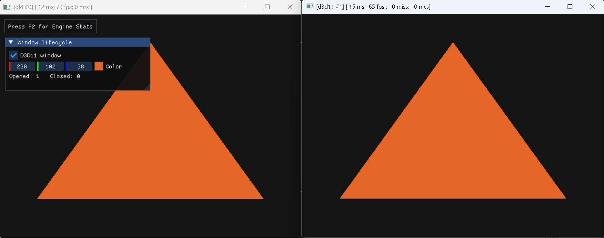

### 02 Dynamic Geometry

Add and remove a square at runtime using geometry links and variable sets,
without reconfiguring the entire shader for every change.

[Source](suite_graphics/02_dynamic_geometry.cpp) | [Run guide](BUILDING.md#dynamic-geometry-and-variable-sets)

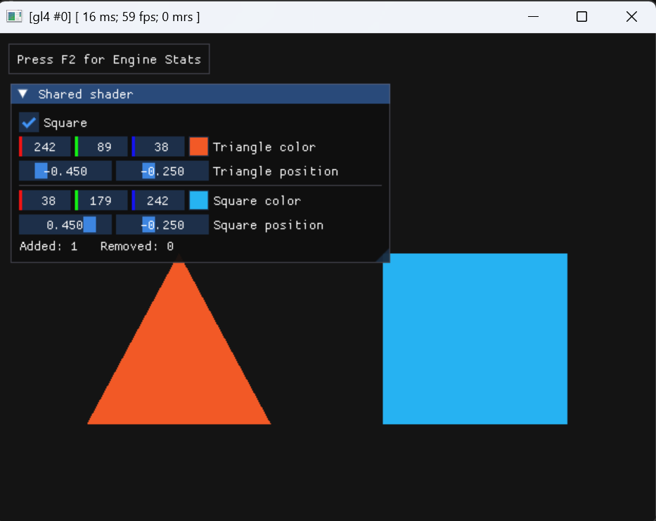

### 03 Shared Scene

Three animated cubes exercise shared resources, sparse variable-set IDs,
different draw order and secondary-window recreation.

[Source](suite_graphics/03_shared_scene.cpp) | [Guide and verification](suite_graphics/03_shared_scene.md)

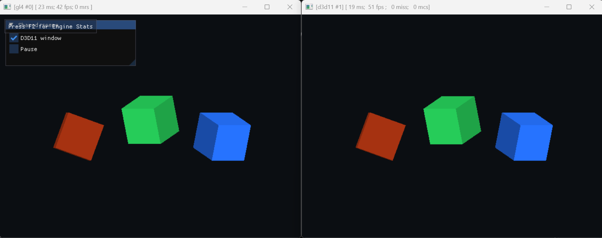

### 04 Configure and Reconfigure

Two checkerboard-textured quads test independent texture changes, reconfiguration
and release followed by configuration, on one or both backends.

[Source](suite_graphics/04_reconfigure.cpp) | [Guide and verification](suite_graphics/04_reconfigure.md)

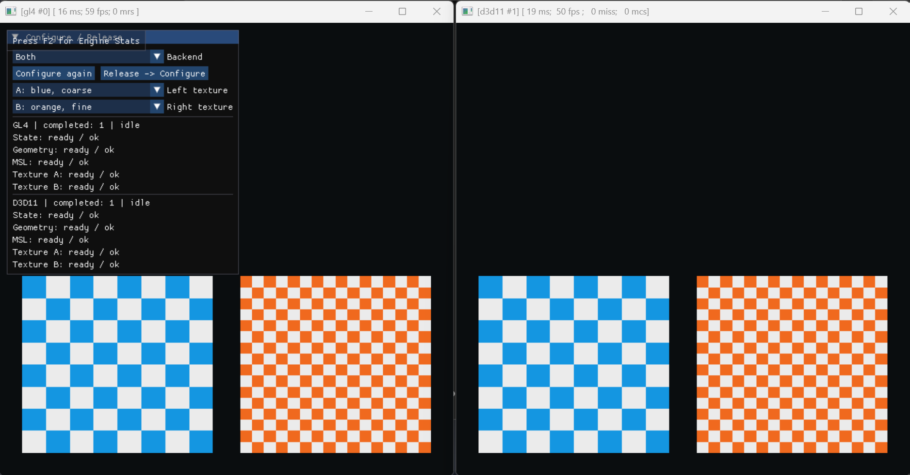

### 05 Scene Benchmark

Configurable object and light counts compare direct rendering with scene-graph
traversal, and multipass lighting with two or three lights evaluated in one pass.

[Source](suite_graphics/05_scene_benchmark.cpp) | [Methodology and results](suite_graphics/05_scene_benchmark.md) | [Benchmark runner](suite_graphics/run_scene_benchmark.ps1)

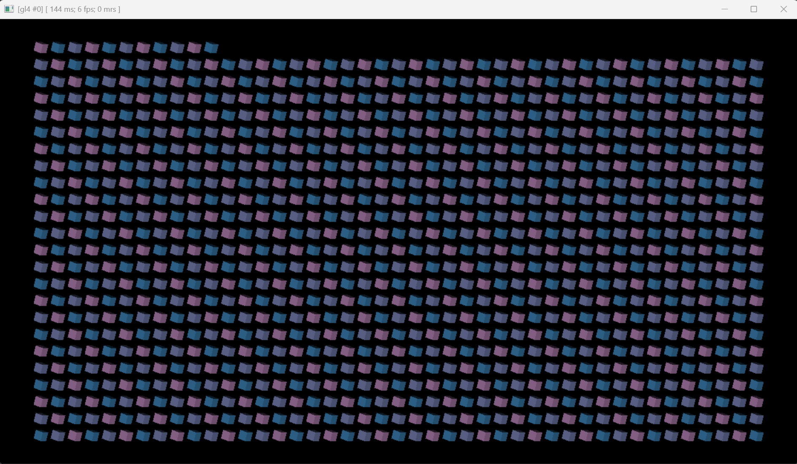

### 06 Vertex Pulling

Side-by-side comparison of vertex data fetched from an array buffer and the
same geometry rendered through conventional vertex attributes.

[Source](suite_graphics/06_vertex_pulling.cpp) | [Guide and verification](suite_graphics/06_vertex_pulling.md)

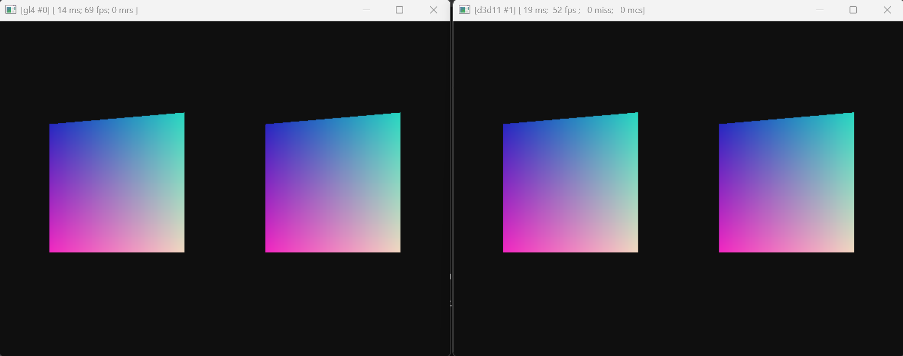

### 07 Vertex Pulling Field

A wave field of rounded cubes with shared mesh data and per-object data in
array buffers. The scene is submitted as one indexed draw per window.

[Source](suite_graphics/07_vertex_pulling_field.cpp) | [Workloads and controls](suite_graphics/07_vertex_pulling_field.md)

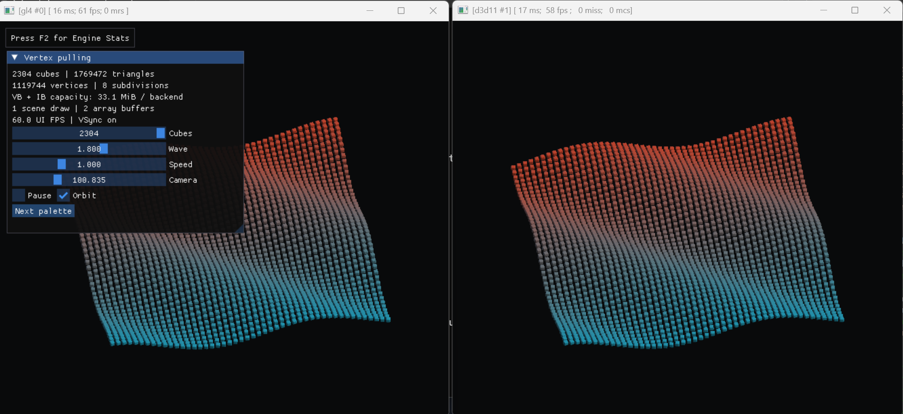

### 08 Render to Texture

Render animated cubes into a framebuffer, then display its color target through
a post-processing shader. Exercises target orientation, resizing and render states.

[Source](suite_graphics/08_render_to_texture.cpp) | [Guide and verification](suite_graphics/08_render_to_texture.md)

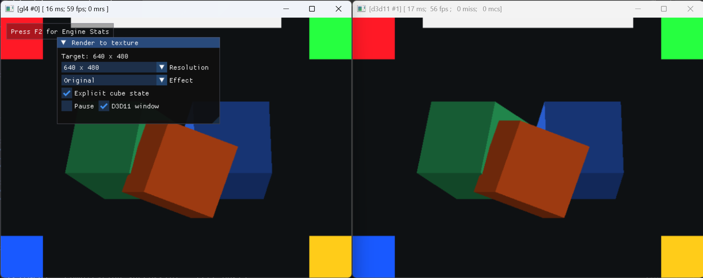

### 09 Geometry Shader

Compare a reference mesh with geometry-shader variants, including triangle
displacement and an additional shell.

[Source and command-line options](suite_graphics/09_geometry_shader.cpp)

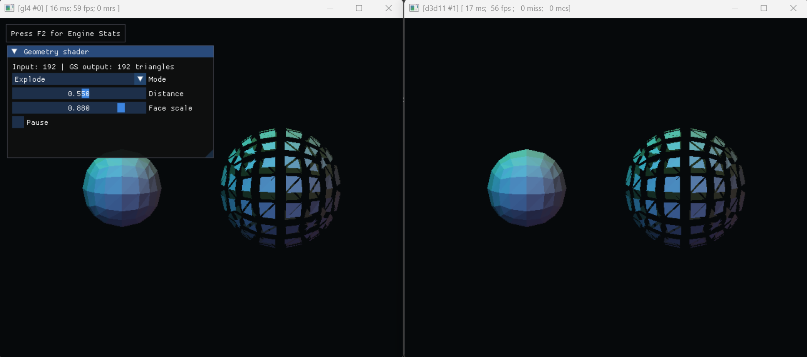

### 10 Transform Feedback

Capture and filter a 50 x 50 x 50 lattice on the GPU, then render the retained
points as cubes. A visible cutting plane illustrates the geometry-shader filter.

[Source](suite_graphics/10_transform_feedback.cpp) | [Modes and verification](suite_graphics/10_transform_feedback.md)

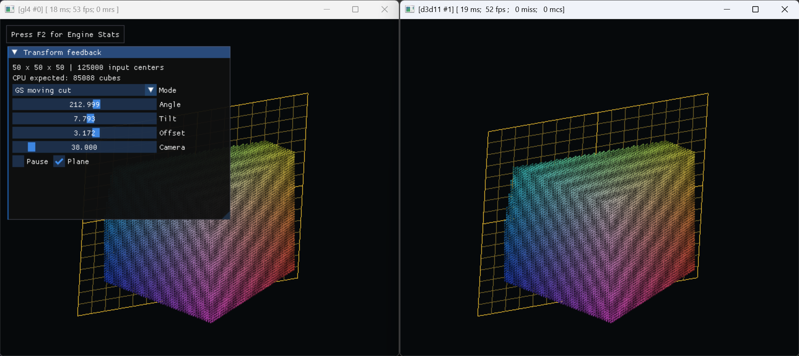

### 11 Lighting Gallery

A small scene with cubes, spheres, tori and a checkerboard floor, lit by three
colored directional lights. Compare single-pass and additive multipass lighting.

[Source](suite_graphics/11_lighting_scene.cpp) | [Rendering paths and controls](suite_graphics/11_lighting_scene.md)

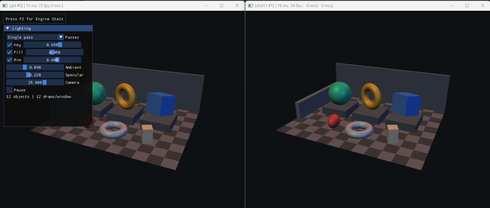

### 12 Scene Graph + Wire Lighting + HDR

The gallery built around scene nodes, components and visitors. Wire slots drive
transforms, material and light values; a parent group moves the exhibits, and
two camera views use separate render-data subsets in the same graph.
motor's gfx post-processing pipeline adds Bloom, tone mapping and FXAA, with
editable stage properties and a direct-rendering comparison switch.

[Source](suite_graphics/12_scene_wire_lighting.cpp) | [Graph, data flow and verification](suite_graphics/12_scene_wire_lighting.md)

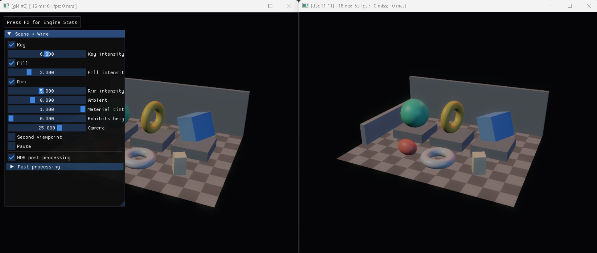

### 14 Light Components

Colored directional and moving point lights collected from scene components, then
rendered with the engine light-pass visitor using each light's color and intensity.
Includes additive passes, per-light/view subsets, controls, and a smoke sequence
that changes light types and order.

[Source](suite_graphics/14_light_components.cpp) | [Data flow and current limits](suite_graphics/14_light_components.md)

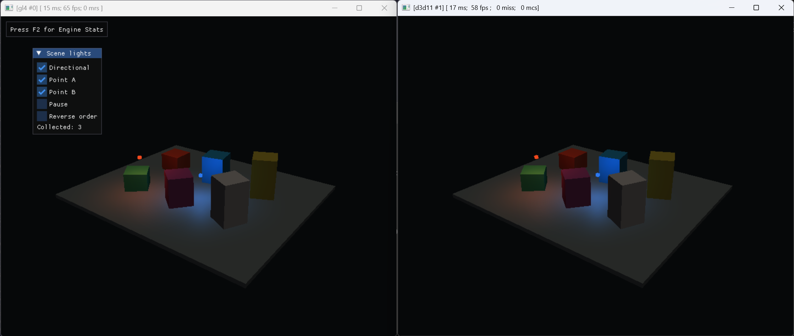

### 15 Village 1800

Four procedural half-timber houses around a cobbled square, with individual roof
tiles, a well, cart, barrels and vegetation. The default scene contains 323,145
triangles and 8,192 particle seeds. Smoke, sparks and drifting motes are generated
through transform feedback / stream output and rendered as soft billboards.
Includes HDR, bloom, FXAA, camera controls, density presets and optional dual
OpenGL/D3D11 windows. A procedural dragon circles the village with shader-animated
wings and tail, plus optional fire breath. The UI reports per-window draw counts.
Village and dragon use the scene graph and render visitor. Two directional
lights and one point light are collected from light components; Wire connects
their values to the shared shader. No external assets are required.
Eleven material types are rendered in 41 scene batches with individual surface
parameters. Houses include tiled dormers, detailed windows on every facade,
flower boxes, entrance canopies, iron fittings, lanterns and hanging signs.
Rounded roof tiles, ridge caps, detailed window/door trim and refined well/cart
geometry add further detail. Directional moonlight casts PCF-filtered shadows
through motor's camera, depth framebuffer, msl bindings and scene visitors.

[Source](suite_graphics/15_village.cpp) | [Run guide and limitations](suite_graphics/15_village.md)

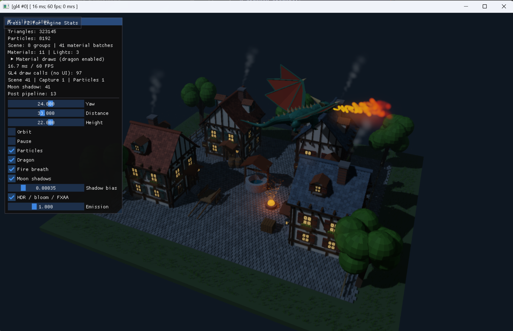

### 16 Async Asset Loading

Load Sponza asynchronously, then insert Suzanne while Sponza continues rendering.
Uses motor's IO database, module registry, scene graph and runtime shader
configuration. A texture-free normal-color shader makes the imported geometry
readable without lights. Includes camera controls and a pending-import shutdown test.

[Source](suite_graphics/16_async_assets.cpp) | [Guide and import limitations](suite_graphics/16_async_assets.md) | [Model credits](suite_graphics/assets/async_loading/ATTRIBUTION.md)

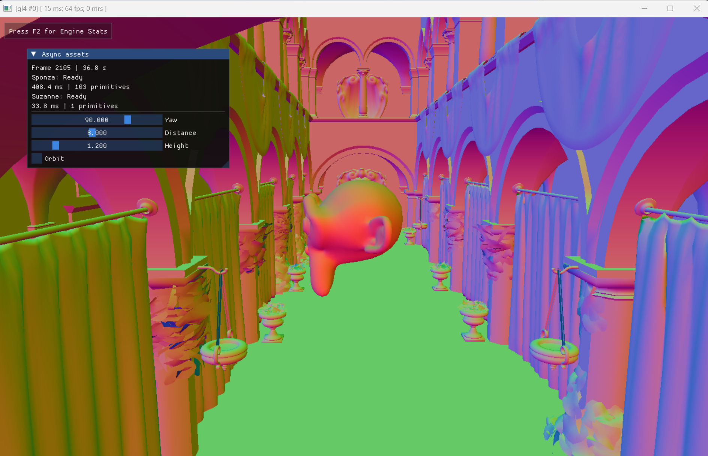

### 17 Debug Primitives

Orbit around point-light circles, directional arrows, perspective camera frusta
and orthographic camera boxes. Opaque triangles provide a depth-test reference.
Controls cover radius, segment count, near/far visualization, overlay mode and
empty frames. Uses motor's wire-circle, wire-sphere, arrow and frustum primitives
without custom shaders; includes camera-projection regression checks.

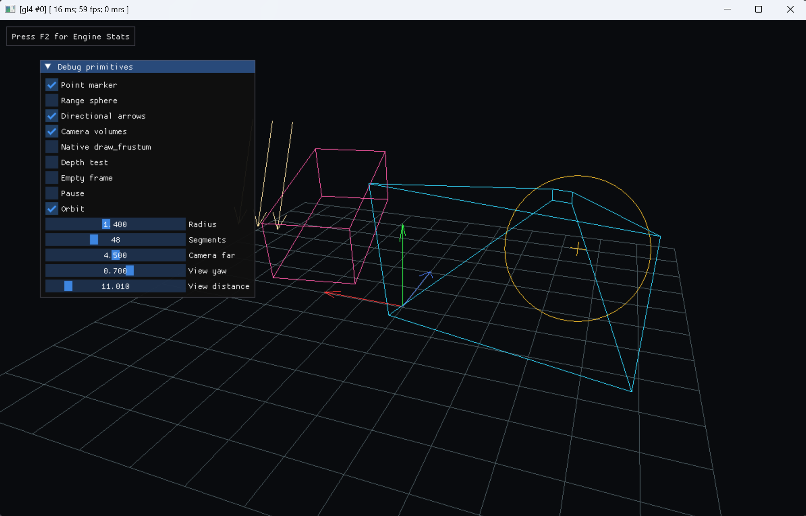

[Source](suite_graphics/17_debug_primitives.cpp) | [Guide and known limitations](suite_graphics/17_debug_primitives.md)

### 20 Noise Playground

Eight msl noise variants, displayed as a labeled 2D comparison or an animated
procedural landscape. Includes height/slope coloring, finite-difference normals,
camera orbit and ImGui controls. One 1920x1080 window, GL4 or D3D11.
Optional Demo mode cycles views every second with continuously animated parameters.

[Source](suite_graphics/20_noise_playground.cpp) | [Guide, verification and fbm dependency issue](suite_graphics/20_noise_playground.md)

## Console Tests

These applications do not render a scene. Their output consists of checks,
diagnostics and, where applicable, benchmark measurements.

| Area | Application | Purpose | Documentation |
| --- | --- | --- | --- |
| Concurrency | [00_threads_parallel_for](suite_concurrent/00_threads_parallel_for.cpp) | Native threads, motor's pool, ranges and nested parallel work | [Concurrent tests](BUILDING.md#concurrent-console-tests) |
| Concurrency | [01_sync_primitives](suite_concurrent/01_sync_primitives.cpp) | Semaphore, signals, shared readers and writer exclusion | [Synchronization tests](suite_concurrent/README.md) |
| Concurrency | [02_task_graph](suite_concurrent/02_task_graph.cpp) | Chain, diamond and fan-out graphs with both schedulers | [Task-graph tests](suite_concurrent/README.md) |
| Memory | [00_memory_ownership](suite_memory/00_memory_ownership.cpp) | Share, borrow, move, release guards and concurrent reference counting | [Memory tests](suite_memory/README.md) |
| Memory | [01_memory_allocations](suite_memory/01_memory_allocations.cpp) | Allocation accounting, array destruction, containers and malloc guards | [Memory tests](suite_memory/README.md) |
| Wire | [00_wire_slots](suite_wire/00_wire_slots.cpp) | Fan-out, exchange, type checks and connection lifetime | [Wire tests](BUILDING.md#wire-console-tests) |
| Wire | [01_wire_bridges](suite_wire/01_wire_bridges.cpp) | Input/output bridges, rebinding and variable-set replacement | [Wire tests](BUILDING.md#wire-console-tests) |
| Core | [00_document](suite_core/00_document.cpp) | Token correctness and comparison with standard-library approaches | [Document tests](suite_core/README.md) |
| Core / IO | [01_document_obj](suite_core/01_document_obj.cpp) | Load OBJ text through motor's database and compare tokenization | [OBJ benchmark](suite_core/README.md#sponza-obj-via-motor-io) |
| Core | [03_component_search](suite_core/03_component_search.cpp) | Compare RTTI, type-ID lookup and single-pass dispatch with 1-5 components | [Component lookup](suite_core/README.md#component-lookup) |
| Core / Graphics | [04_command_storage](suite_core/04_command_storage.cpp) | Command creation and clearing versus reusable indexed slots | [Command storage](suite_core/README.md#command-storage) |
| Math | [00_vector](suite_math/00_vector.cpp) | Arithmetic, normalization and cross products | [Math tests](suite_math/README.md) |
| Math | [01_matrix](suite_math/01_matrix.cpp) | Products, transpose, homogeneous coordinates and 2D rotation | [Math tests](suite_math/README.md) |
| Math | [02_transformation](suite_math/02_transformation.cpp) | TRS, hierarchy, cameras and projection | [Math tests](suite_math/README.md) |
| Math | [03_util](suite_math/03_util.cpp) | Scalar functions, angles, time, indices and orthonormal bases | [Math tests](suite_math/README.md) |
| Math | [04_quaternion](suite_math/04_quaternion.cpp) | Axis rotations, composition, matrix conversion and SLERP | [Math tests](suite_math/README.md) |

## Testing and CI

Build all targets, then run the console suites:

```sh
cmake --build build --config Release --parallel 4
ctest --test-dir build -C Release -L "concurrent|wire|core|math|memory" --output-on-failure --no-tests=error
```

The [Windows build](.github/workflows/cmake-win32-dx11.yml) and
[Linux build](.github/workflows/cmake-lin-gcc-gl.yml) compile all targets in Debug
and Release. Separate [Windows CTest](.github/workflows/ctest-win32.yml) and
[Linux CTest](.github/workflows/ctest-linux.yml) workflows build only the console
test targets and their dependencies, then execute these tests in both configurations.
Each badge reports its own workflow: a test failure does not fail the build workflow.
The CTest status includes its configure/build prerequisites, not just test assertions.
The workflows run independently on pushes and pull requests to main, or manually;
they do not transfer build artifacts between jobs. This repeats compilation of
the console tests and their dependencies, but does not rebuild the graphics samples
in the CTest workflows. Graphics-runtime and pixel verification are not covered.
The OBJ test is registered only when its external test asset is present at
CMake configuration time.

Graphics smoke tests require a suitable interactive desktop and graphics driver.
Their linked documents explain the checked conditions and known limitations.
A successful smoke run is not automatically a correct-image test; memory dumps
cover motor-tracked allocations, not every possible GPU allocation.

Older observations and timings document particular engine revisions and machines.
They should not be read as current failures or universal performance guarantees.
